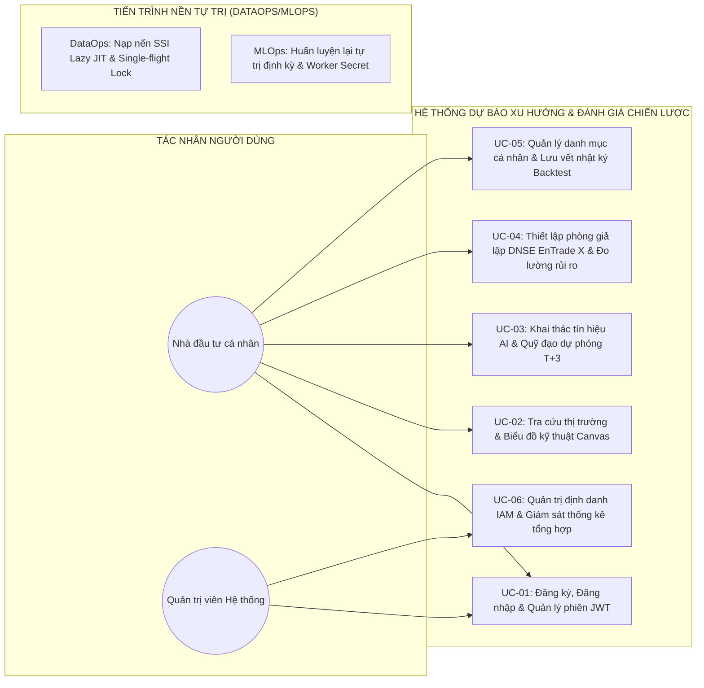
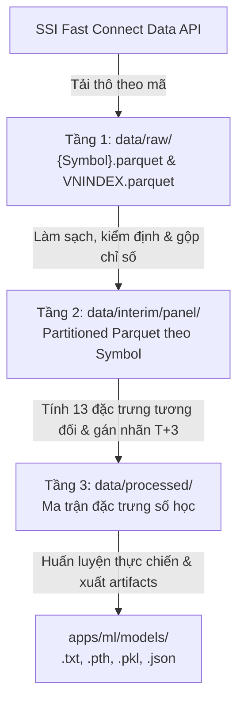
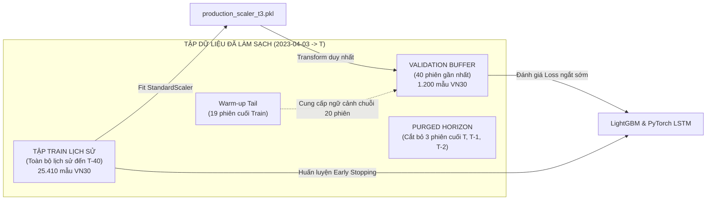
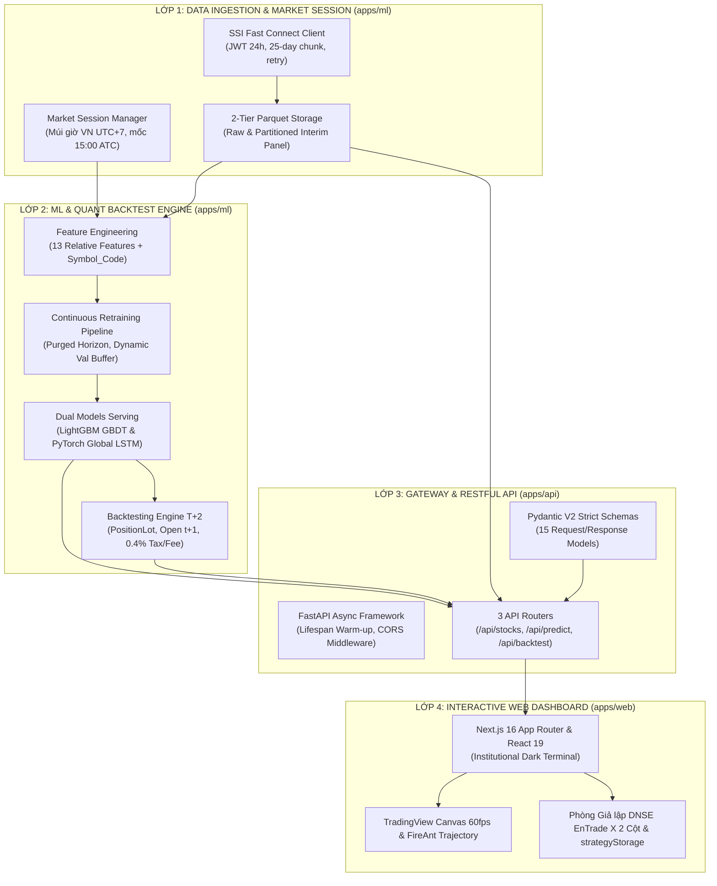
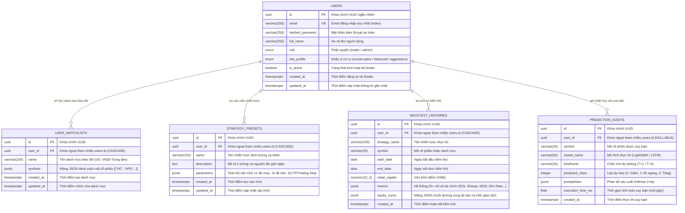

# CHƯƠNG 3: KHẢO SÁT NGHIỆP VỤ VÀ THIẾT KẾ HỆ THỐNG

---

## 3.1. PHÂN TÍCH YÊU CẦU BÀI TOÁN VÀ CA SỬ DỤNG NGHIỆP VỤ (USE CASES)

### 3.1.1. Khảo sát nghiệp vụ và nhịp sinh học phiên giao dịch

Để xây dựng một hệ thống Trí tuệ Nhân tạo hỗ trợ ra quyết định đầu tư có giá trị thực tiễn cao, việc khảo sát thực tế hành vi tâm lý của nhà đầu tư cá nhân và các ràng buộc vận hành vi cấu trúc trên thị trường chứng khoán Việt Nam (đặc thù sàn HOSE) là yêu cầu tiên quyết. Khác với các thị trường tài chính phát triển (vận hành liên tục 24/7 hoặc hỗ trợ giao dịch hai chiều T+0), thị trường cơ sở Việt Nam vận động tuần hoàn theo 4 khung giờ sinh học chính trong mỗi ngày giao dịch:

1. **Khung giờ trước phiên mở cửa (08:30 – 09:00):**  
   Nhà đầu tư cá nhân và các chuyên viên định lượng tiếp nhận các luồng tin tức kinh tế vĩ mô, báo cáo tài chính doanh nghiệp công bố ngoài giờ và diễn biến chỉ số tài chính quốc tế (Dow Jones, S&P 500, Nikkei). Ở giai đoạn này, nhà đầu tư có nhu cầu rà soát lại danh mục hiện hữu, kiểm tra trạng thái các chiến lược đầu tư đang kích hoạt theo dõi và xem xét các tín hiệu định lượng để chuẩn bị lệnh giao dịch cho phiên sáng.
2. **Khung giờ trong phiên giao dịch liên tục (09:00 – 14:30):**  
   Bao gồm phiên khớp lệnh định kỳ mở cửa ATO (09:00 – 09:15) và hai phiên khớp lệnh liên tục (09:15 – 11:30 và 13:00 – 14:30). Trong giai đoạn này, bảng điện tử biến động liên tục với hàng nghìn giao dịch mỗi giây. Sự biến động giá ngắn hạn nội phiên rất dễ kích hoạt các thiên kiến tâm lý sai lầm như hưng phấn mua đuổi giá trần (FOMO) hoặc hoảng loạn bán tháo khi thị trường rung lắc.  
   Đặc biệt, trong khoảng thời gian này, cây nến ngày hôm nay ($t$) chưa hoàn chỉnh do mức giá đóng cửa chính thức chưa được xác lập tại phiên ATC. Nếu một hệ thống đưa ra các tín hiệu dự báo vội vã dựa trên mức giá dở dang nội phiên, nhà đầu tư sẽ đối mặt với rủi ro sai lệch thời điểm quyết định (Decision-Time Leakage `[1]`), dẫn đến các quyết định giao dịch thua lỗ.
3. **Khung giờ khớp lệnh định kỳ đóng cửa ATC và Chốt ngày (14:30 – 15:00):**  
   Phiên khớp lệnh định kỳ đóng cửa ATC (14:30 – 14:45) là thời điểm quan trọng nhất trong ngày, xác lập mức giá đóng cửa chính thức ($Close$) mang tính pháp lý cao nhất của từng cổ phiếu. Khoảng thời gian từ 14:45 đến 15:00 là thời điểm Sở Giao dịch Chứng khoán và các công ty chứng khoán (như SSI) hoàn tất tổng hợp và đóng băng chuỗi nến ngày hoàn chỉnh.
4. **Khung giờ sau phiên giao dịch (sau 15:00 UTC+7):**  
   Đây là "thời điểm vàng" trong chu trình phân tích định lượng. Khi thị trường đã đóng cửa và nến ngày đã chốt nguyên vẹn, tâm lý nhà đầu tư trở về trạng thái ổn định và duy lý. Đây là thời điểm thích hợp nhất để hệ thống kích hoạt luồng suy luận trực tuyến an toàn (Live Inference), chạy dự phóng Quỹ đạo $T+1 \to T+3$, kích hoạt huấn luyện lại mô hình học máy (Continuous Retraining) và cho phép người dùng kiểm thử giả lập lại các chiến thuật định lượng trước khi bước vào ngày giao dịch tiếp theo.

---

### 3.1.2. Phân tích yêu cầu chức năng thực chiến (FR-01 đến FR-08)

Dựa trên kết quả khảo sát nhịp sinh học và nghiệp vụ đầu tư, hệ thống được thiết kế đáp ứng 8 yêu cầu chức năng cốt lõi (Functional Requirements - FR):

* **FR-01: Thu nhận và Đồng bộ dữ liệu nến nối đuôi gia tăng (Incremental Data Sync):**  
  Tự động kết nối tới cổng SSI Fast Connect API, kiểm tra phiên chốt cuối cùng trong kho lưu trữ Parquet cục bộ, chỉ tải nối đuôi các phiên giao dịch mới phát sinh mà không cần tải lại toàn bộ lịch sử, áp dụng cơ chế ghi đĩa nguyên tử (Atomic Write) bảo đảm an toàn dữ liệu.
* **FR-02: Kỹ nghệ đặc trưng và Quản lý phiên thời gian thực (Feature Engineering & Market Session):**  
  Tự động tính toán 13 chỉ báo kỹ thuật tương đối không thứ nguyên và mã hóa định danh cổ phiếu; tự động nhận diện múi giờ chuẩn Việt Nam (UTC+7) và mốc 15:00 kết thúc phiên ATC để bảo toàn tính nhân quả thời gian thực.
* **FR-03: Suy luận AI trực tuyến và Dự phóng Quỹ đạo T+3 (Live AI Prediction & Multi-horizon Trajectory):**  
  Cung cấp dịch vụ suy luận thời gian thực qua REST API (`/api/predict/live`), xuất phân bổ xác suất Softmax 3 lớp, mức độ tin cậy (Confidence) và trực quan hóa Quỹ đạo 3 phiên $T+1 \to T+3$ bám sát chu kỳ bù trừ thanh toán của Tổng công ty Lưu ký và Bù trừ Chứng khoán Việt Nam (VSDC).
* **FR-04: Tiến trình Tự trị Huấn luyện lại Định kỳ Hàng tuần (DataOps/MLOps Scheduled Retrain Worker):**  
  Tự động kích hoạt định kỳ qua worker nền nội bộ bảo vệ bởi mã bí mật `X-Internal-Worker-Secret` (triệt tiêu hoàn toàn nguy cơ tấn công từ chối dịch vụ DoS, không mở endpoint kích hoạt công khai trên giao diện), huấn luyện lại song song hai mô hình LightGBM GBDT và PyTorch Global LSTM trên 100% dữ liệu lịch sử tích lũy đến $T-40$, cô lập Bộ đệm Thẩm định Động (Dynamic Validation Buffer) 40 phiên và áp dụng kỹ thuật Purged Horizon cắt bỏ 3 phiên cuối, tự động cập nhật và xuất các bộ artifacts sản xuất.
* **FR-05: Động cơ kiểm thử chiến lược sát vi cấu trúc và Kiểm định Monte Carlo (Backtesting Engine):**  
  Mô phỏng khớp lệnh tại giá mở cửa phiên kế tiếp $Open_{t+1}$ kèm trượt giá $0.05\%$, quản lý trạng thái từng lô cổ phiếu qua dataclass `PositionLot` tuân thủ nghiêm ngặt chu kỳ $T+2$, khấu trừ đầy đủ thuế chuyển nhượng $0.10\%$, phí môi giới $0.15\%$ mỗi chiều, làm tròn lô chẵn 100 cổ phiếu, tính toán hệ thống 25+ chỉ số tài chính và chạy kiểm định hoán vị ngẫu nhiên Monte Carlo 100 lần.
* **FR-06: Phân hệ Quản lý Chiến thuật cá nhân chuẩn sàn DNSE EnTrade X:**  
  Cung cấp 2 chế độ: Chế độ Quản lý Chiến thuật (bộ ba nút lọc "Tất cả", "Triển khai" - Active, "Chưa triển khai" - Draft); Chế độ Phòng Lab Kiểm thử (tùy biến 12 điều kiện mua, 12 điều kiện bán, danh mục 8 chiến lược mẫu và quy tắc quản trị rủi ro tự động Stop Loss, Take Profit, Trailing Stop).
* **FR-07: Giao diện Web Dashboard Trực quan Tương tác cao:**  
  Trực quan hóa biểu đồ nến Canvas TradingView Lightweight Charts v5.2 đạt tốc độ 60fps, nhúng biểu đồ FireAnt kết hợp Quỹ đạo $T+3$, biểu đồ đường cong tài sản tích lũy (Equity Curve) so sánh song song với Buy & Hold và bảng phân tích chi tiết từng deal giao dịch.
* **FR-08: Quản trị Định danh IAM, Phân quyền Truy cập và Giám sát Thống kê Tổng hợp Người dùng (User Auth, IAM & Aggregated Stats):**  
  Hỗ trợ đăng ký và đăng nhập tài khoản an toàn với mật khẩu băm Bcrypt; quản lý phiên với cơ chế Dual JWT (Access Token trong Bearer Header & Refresh Token); phân quyền người dùng (Role-Based Access Control: `trader`, `admin`); tuân thủ nghiêm ngặt nguyên tắc đặc quyền tối thiểu (PoLP): Quản trị viên chỉ quản trị tài khoản và giám sát 5 chỉ số thống kê tổng hợp (`total_users`, `new_users_today`, `new_users_7d`, `new_users_30d` tính theo 0h00 UTC+7 và `online_users` trong 5 phút), tuyệt đối không xem hay can thiệp vào chiến lược, watchlist, preset hay nhật ký backtest của người dùng khác; bảo đảm cách ly dữ liệu tầng ứng dụng (application-level tenant isolation) theo `where(Model.user_id == current_user.id)` (mọi truy vấn vào ID tài nguyên người khác trả về HTTP 404). Hệ thống không dùng cụm từ "bảo mật tuyệt đối 100%" mà áp dụng cơ chế phòng thủ theo chiều sâu (Defense-in-Depth).

Bảng 3.1: Danh mục đặc tả 8 yêu cầu chức năng thực chiến của hệ thống
| Mã yêu cầu | Tên yêu cầu chức năng | Phân hệ phụ trách | Mức độ ưu tiên |
| :---: | :--- | :--- | :---: |
| **FR-01** | Đồng bộ nến nối đuôi gia tăng | apps/ml (ssi_client.py, data_ingestion.py) | Bắt buộc (P0) |
| **FR-02** | Kỹ nghệ đặc trưng & Quản lý phiên | apps/ml (features.py, market_session.py) | Bắt buộc (P0) |
| **FR-03** | Suy luận AI & Quỹ đạo T+3 | apps/ml (predict.py), apps/api, apps/web | Bắt buộc (P0) |
| **FR-04** | Tiến trình Tự trị Huấn luyện lại Định kỳ | apps/ml (train.py), apps/api (internal worker) | Bắt buộc (P0) |
| **FR-05** | Động cơ Backtest T+2 & Monte Carlo | apps/ml (backtest.py), apps/api | Bắt buộc (P0) |
| **FR-06** | Quản lý Chiến thuật DNSE EnTrade X | apps/web (strategyStorage.ts), apps/api | Bắt buộc (P0) |
| **FR-07** | Giao diện Web Dashboard Trực quan | apps/web (Next.js 16, Lightweight Charts) | Bắt buộc (P0) |
| **FR-08** | Quản trị Định danh IAM & Thống kê | apps/api (auth, admin), apps/web (AdminDashboard) | Bắt buộc (P0) |

---

### 3.1.3. Phân tích yêu cầu phi chức năng (NFR-01 đến NFR-04)

Hệ thống phải tuân thủ nghiêm ngặt 4 yêu cầu phi chức năng (Non-Functional Requirements - NFR) đảm bảo độ tin cậy và khả năng ứng dụng thực tế:

* **NFR-01: Hiệu năng và Độ trễ (Performance & Latency):**  
  - Thời gian phản hồi của các API truy vấn nến lịch sử và chỉ báo kỹ thuật phải dưới 500ms đối với dữ liệu đã lưu sẵn trong bộ đệm Parquet.
  - Thời gian thực thi luồng suy luận thời gian thực kèm tính toán Quỹ đạo 3 phiên (`/api/predict/live`) phải dưới 500ms khi dữ liệu đã có sẵn, và dưới 1.500ms khi cần kích hoạt đồng bộ nến mới từ cổng SSI API.
  - Thời gian chạy mô phỏng kiểm thử chiến lược danh mục đa tài sản (Backtest) trên toàn bộ chuỗi nến lịch sử phải hoàn tất trong vòng dưới 800ms.
* **NFR-02: Tính toàn vẹn và Liêm chính học thuật (Zero Data Leakage):**  
  - Triệt tiêu $100\%$ rò rỉ nhìn trước tương lai (Lookahead Bias): mọi đặc trưng kỹ thuật tại thời điểm $t$ chỉ được tính toán dựa trên dữ liệu lịch sử từ $t$ trở về trước.
  - Triệt tiêu $100\%$ rò rỉ thời điểm quyết định (Decision-Time Leakage `[1]`): lệnh giao dịch sinh ra từ giá đóng cửa phiên $t$ chỉ được phép khớp lệnh tại giá mở cửa phiên kế tiếp $Open_{t+1}$ kèm tỷ lệ trượt giá.
* **NFR-03: Độ tin cậy và Độ bao phủ kiểm thử tự động (Reliability & Test Coverage):**  
  - Toàn bộ các module cốt lõi của hệ thống phải được bảo chứng bằng bộ kiểm thử tự động toàn diện đạt tỷ lệ vượt qua tuyệt đối $100\%$ (**530/530 automated tests PASSED**).
  - Phân bổ kiểm thử gồm: 87 tests E2E Opaque-box 4 tầng (tests/e2e), 156 tests Backend API & Security (apps/api), 32 tests Docker & Infrastructure (infra/tests), 96 tests ML & Backtesting Engine (apps/ml), và 159 tests Frontend Vitest (apps/web).
* **NFR-04: Trải nghiệm thị giác và Chuẩn mực thiết kế (UI/UX & Institutional Standard):**  
  - Giao diện người dùng Web Dashboard được thiết kế theo phong cách Institutional Trading Terminal hiện đại, tông màu tối cao cấp (Slate 950 / Zinc 950) giúp giảm mỏi mắt, độ tương phản chữ đạt chuẩn WCAG AAA.
  - Biểu đồ nến kỹ thuật vẽ trên HTML5 Canvas đạt tốc độ dựng hình mượt mà 60fps ngay cả khi tải chuỗi dữ liệu hàng nghìn thanh nến.

---

### 3.1.4. Phân tích tác nhân, Tiến trình tự trị, Biểu đồ ca sử dụng và Đối chiếu Chuẩn mực Đạo đức CFA

Hệ thống xác định hai nhóm tác nhân người dùng và phân định rõ ranh giới với các tiến trình nền tự trị của máy móc:

1. **Nhà đầu tư cá nhân (Retail User):** Là người sử dụng giao diện Web Dashboard để theo dõi diễn biến thị trường, khai thác tín hiệu AI và Quỹ đạo dự phóng $T+3$, thiết lập phòng giả lập kiểm thử chiến lược giao dịch định lượng chuẩn sàn DNSE EnTrade X phù hợp với khẩu vị rủi ro cá nhân hóa (Bảo thủ - `conservative`, Cân bằng - `balanced`, Tăng trưởng mạo hiểm - `aggressive`), đồng thời sở hữu và quản lý các bộ tham số đầu tư độc lập (Watchlists, Presets, Backtest Experiments). Toàn bộ dữ liệu của người dùng được cách ly nghiêm ngặt ở tầng ứng dụng (application-level tenant isolation) theo điều kiện ràng buộc khóa ngoại `where(Model.user_id == current_user.id)`. Hệ thống không sử dụng tuyên bố "bảo mật tuyệt đối 100%" (vốn là điều phi thực tế trong bảo mật an ninh mạng) mà áp dụng mô hình phòng thủ theo chiều sâu (Defense-in-Depth).
2. **Quản trị viên Hệ thống (System Administrator):** Là nhân sự vận hành tuân thủ nghiêm ngặt Nguyên tắc Đặc quyền Tối thiểu (Principle of Least Privilege - PoLP). Quản trị viên chỉ có quyền quản trị định danh và phân quyền truy cập (IAM - khóa/mở tài khoản, quản lý vai trò `admin` hoặc `trader`) và giám sát 5 chỉ số thống kê tổng hợp hệ thống (`total_users`, `new_users_today`, `new_users_7d`, `new_users_30d` tính theo 0h00 UTC+7 và `online_users` hoạt động trong 5 phút gần nhất). Quản trị viên tuyệt đối không có quyền truy cập, tra cứu hay can thiệp vào chiến lược đầu tư, watchlist, preset hay kết quả backtest của người dùng khác (mọi truy vấn vào ID tài nguyên người khác đều bị chặn và trả về HTTP 404).
3. **Hệ thống Tiến trình Nền Tự trị (System Autonomous Background Services - DataOps/MLOps):** Các tác vụ hạ tầng như nạp nến SSI Fast Connect API (Lazy JIT Fetch với Single-flight Lock chống cạn kiệt hạn mức Rate Limit) và Tiến trình tự trị huấn luyện lại định kỳ hàng tuần (Scheduled Production Retrain Worker với mã bảo vệ nội bộ `INTERNAL_WORKER_SECRET`) được tách rời khỏi nhóm ca sử dụng của con người, tự động vận hành trong nền mà không yêu cầu can thiệp thủ công.



Đặc tả chi tiết 6 ca sử dụng chuẩn hóa:

* **UC-01: Đăng ký, Đăng nhập và Quản lý phiên xác thực JWT:**  
  - *Mô tả:* Người dùng đăng ký tài khoản với email, họ tên, mật khẩu băm Bcrypt và chọn khẩu vị rủi ro (`conservative`, `balanced`, `aggressive`); đăng nhập nhận cặp token bảo mật Dual JWT (Access Token & Refresh Token) để truy cập các dịch vụ cá nhân hóa. Mỗi truy vấn tự động cập nhật mốc hoạt động `last_seen_at` phục vụ thống kê trực tuyến.
* **UC-02: Tra cứu thị trường và Biểu đồ kỹ thuật Canvas:**  
  - *Mô tả:* Người dùng chọn mã cổ phiếu thuộc rổ VN30 hoặc chỉ số VN-Index, hệ thống hiển thị biểu đồ nến OHLCV Canvas TradingView kèm đường SMA(20), cột khối lượng phân màu và đồ thị dao động RSI(14).
* **UC-03: Khai thác tín hiệu AI và Dự phóng Quỹ đạo Chu kỳ T+3:**  
  - *Mô tả:* Người dùng chọn mô hình (LightGBM hoặc PyTorch Global LSTM), hệ thống hiển thị huy hiệu trạng thái tự trị ("Mô hình AI tự động cập nhật định kỳ hàng tuần | Căn cứ phiên chốt: [ngày ATC]"), thẻ khuyến nghị màu (MUA / BÁN / NẮM GIỮ), thanh radar phân bổ xác suất Softmax 3 lớp, mức tin cậy % và biểu đồ Quỹ đạo 3 phiên theo chu kỳ thanh toán VSDC.
* **UC-04: Thiết lập phòng giả lập chiến lược DNSE EnTrade X và Đo lường rủi ro:**  
  - *Mô tả:* Người dùng tùy biến 12 điều kiện mua, 12 điều kiện bán, chọn 8 chiến lược mẫu, thiết lập quy tắc cắt lỗ/chốt lời/trailing stop phù hợp với khẩu vị rủi ro, chạy backtest danh mục trừ đủ thuế phí và quan sát 25 chỉ số tài chính, đường cong tài sản và kiểm định Monte Carlo 100 lần.
* **UC-05: Quản lý danh mục cá nhân và Lưu vết nhật ký Backtest:**  
  - *Mô tả:* Người dùng tạo, sửa, xóa các danh mục theo dõi yêu thích (Watchlists), các bộ tham số mẫu (Presets) và lưu kết quả thực nghiệm backtest vào CSDL PostgreSQL 16 gắn liền với `current_user.id`. Dữ liệu được cách ly tầng ứng dụng nghiêm ngặt và cho phép lọc theo trạng thái 'Triển khai' (Active) hoặc 'Chưa triển khai' (Draft).
* **UC-06: Quản trị định danh, Phân quyền truy cập và Giám sát thống kê tổng hợp người dùng:**  
  - *Mô tả:* Quản trị viên truy cập trang Thống kê hệ thống, backend trả về 5 chỉ số tổng hợp (`total_users`, `new_users_today`, `new_users_7d`, `new_users_30d`, `online_users`). Tuân thủ PoLP: Admin tuyệt đối không xem được danh sách hoạt động chi tiết, không xem thông tin cá nhân và không có quyền truy cập vào chiến lược hay backtest của người dùng khác.

#### Đối chiếu Chuẩn mực Đạo đức Nghề nghiệp CFA (CFA Institute Code of Ethics & Standards of Professional Conduct)

Trong bối cảnh ứng dụng trí tuệ nhân tạo vào lĩnh vực tài chính và đầu tư định lượng, đạo đức nghề nghiệp là thước đo quyết định độ tin cậy và tính liêm chính của hệ thống. Hệ thống được đối chiếu trực tiếp với Bộ Quy tắc Đạo đức và Chuẩn mực Ứng xử Nghề nghiệp chính thức của Viện CFA Hoa Kỳ (CFA Institute):

* **Standard III(A) Loyalty, Prudence and Care (Lòng trung thành, Cẩn trọng và Chu đáo):**  
  Chuẩn mực quy định thành viên phải luôn đặt lợi ích của khách hàng lên hàng đầu và thực thi sự cẩn trọng tối đa trong hoạt động chuyên môn. Hệ thống hiện thực hóa chuẩn mực này thông qua:  
  1. *Triệt tiêu rò rỉ dữ liệu:* Loại bỏ hoàn toàn thiên kiến nhìn trước tương lai (Lookahead Bias) và không đưa ra tín hiệu dựa trên nến dở dang giữa phiên (tuân thủ mốc 15:00 ATC qua `market_session.py`), bảo vệ nhà đầu tư khỏi các quyết định vội vã, sai lệch.  
  2. *Mô phỏng sát thực vi cấu trúc thị trường Việt Nam:* Động cơ Backtesting khấu trừ đầy đủ phí giao dịch $0.15\%$, thuế chuyển nhượng $0.10\%$, trượt giá $0.05\%$, khớp lệnh tại giá $Open_{t+1}$ và tuân thủ chu kỳ thanh toán $T+2$ của VSDC; không tạo ra những kết quả kiểm thử ảo hay phóng đại lợi nhuận.  
  3. *Minh bạch hóa xác suất định lượng:* Cung cấp phân bổ xác suất Softmax 3 lớp khách quan và mức độ tin cậy toán học, đồng thời phân tầng chiến lược theo 3 khẩu vị rủi ro (`conservative`, `balanced`, `aggressive`) giúp nhà đầu tư quản trị rủi ro danh mục chu đáo.
* **Standard III(E) Preservation of Confidentiality (Bảo toàn tính Bảo mật Thông tin Khách hàng):**  
  Chuẩn mực quy định phải bảo vệ nghiêm ngặt tính bí mật của thông tin khách hàng hiện tại, quá khứ và tiềm năng. Hệ thống tuân thủ chuẩn mực này qua kiến trúc kỹ thuật:  
  1. *Cách ly dữ liệu tầng ứng dụng (Application-level Tenant Isolation):* Mọi truy vấn CSDL liên quan đến tài nguyên cá nhân (danh mục theo dõi, chiến lược mẫu, nhật ký backtest) đều bị ràng buộc chặt chẽ bởi `where(Model.user_id == current_user.id)`. Truy cập tài nguyên của người dùng khác đều bị chặn và trả về HTTP 404 Not Found.  
  2. *Nguyên tắc đặc quyền tối thiểu (PoLP):* Tài khoản Quản trị viên (Admin) bị tước bỏ hoàn toàn quyền truy cập hay can thiệp vào chiến lược đầu tư của người dùng khác. Admin chỉ được giám sát 5 chỉ số thống kê tổng hợp ẩn danh.  
  3. *Phòng thủ theo chiều sâu (Defense-in-Depth):* Mật khẩu được băm một chiều qua Bcrypt, xác thực Dual JWT, các endpoint nội bộ được bảo vệ bằng secret riêng biệt. Hệ thống không sử dụng các tuyên bố tiếp thị phóng đại như "bảo mật tuyệt đối 100%" mà chứng minh sự an toàn qua kiến trúc đa tầng và các bài kiểm thử bảo mật chống xâm nhập nghiêm ngặt.

<p align="center">
  
  <br>
  <em><b>Hình 3.1:</b> Sơ đồ Ca sử dụng tổng thể (Use Case Diagram)</em>
</p>

---

## 3.2. THU THẬP DỮ LIỆU NẾN OHLCV TỪ SSI FAST CONNECT API VÀ QUẢN LÝ PHIÊN GIAO DỊCH

### 3.2.1. Cấu trúc và giao thức SSI Fast Connect API (FC-Data)

Để bảo đảm tính hợp pháp và độ chính xác của dữ liệu đầu vào, đề tài tích hợp trực tiếp với cổng giao diện lập trình ứng dụng chính thức **SSI Fast Connect Data API (FC-Data)** tại địa chỉ `https://fc-data.ssi.com.vn` do Công ty Cổ phần Chứng khoán SSI cung cấp.

Quy trình xác thực và cơ chế quản lý mã thông báo (Token Management) được hiện thực hóa trong lớp `SSIFastConnectClient` tại apps/ml/vn_stock/ssi_client.py:
1. **Xác thực bảo mật bằng khóa đôi:** Hệ thống sử dụng cặp khóa được cấp phép gồm `ConsumerID` và `ConsumerSecret`.
2. **Cơ chế cấp phát JWT Token 24 giờ:** Client gửi yêu cầu HTTP POST tới endpoint `/api/v2/Market/AccessToken` kèm chữ ký số để nhận mã thông báo truy cập JWT (JSON Web Token) có thời hạn hiệu lực 24 giờ.
3. **Bộ nhớ đệm Token an toàn (Token Caching):** Để tránh việc liên tục gửi yêu cầu xin cấp token gây lãng phí tài nguyên mạng, client lưu trữ token trong bộ nhớ đệm cục bộ với thời gian an toàn 6 giờ. Khi token còn hiệu lực trên 6 giờ, hệ thống tái sử dụng token cũ; khi token gần hết hạn, hệ thống tự động gửi yêu cầu làm mới.

Các endpoint dữ liệu chính thức được tích hợp:
* Endpoint nến ngày cổ phiếu: `/api/v2/Market/DailyOhlc` (nhận tham số `symbol`, `fromDate`, `toDate`, `pageIndex`, `pageSize`).
* Endpoint chỉ số toàn thị trường: `/api/v2/Market/DailyIndex` (nhận tham số `indexId="VNINDEX"`, `fromDate`, `toDate`).
* Endpoint danh mục rổ chỉ số: `/api/v2/Market/IndexComponents` (truy vấn 30 mã cấu thành rổ VN30).

---

### 3.2.2. Cơ chế xử lý giới hạn tần suất, phân đoạn chu kỳ và nạp nến nối đuôi gia tăng

Trong quá trình giao tiếp với hệ thống máy chủ của công ty chứng khoán, hai bài toán kỹ thuật hạ tầng đã được giải quyết triệt để:

#### a. Cơ chế Phân đoạn Chu kỳ và Kiểm soát Giới hạn Tần suất (Rate Limiting)
Máy chủ SSI FC-Data áp đặt chính sách giới hạn tần suất truy vấn nghiêm ngặt; nếu gửi yêu cầu truy vấn chuỗi lịch sử vượt quá 30 ngày trong một lần gọi, máy chủ sẽ từ chối phản hồi hoặc trả về tập dữ liệu rỗng. Để khắc phục:
* **Thuật toán chia nhỏ phân đoạn 25 ngày/chunk:** Trong phương thức `get_daily_ohlcv()`, khoảng thời gian truy vấn $[FromDate, ToDate]$ được tự động băm nhỏ thành các phân đoạn liên tiếp có độ dài tối đa 25 ngày giao dịch.
* **Giãn cách an toàn (Rate Limit Sleep):** Giữa các lần gọi phân đoạn, tiến trình chủ động tạm dừng $1.2$ giây (`time.sleep(1.2)`).
* **Cơ chế thử lại lũy thừa (Exponential Backoff Retry):** Khi xảy ra lỗi gián đoạn mạng hoặc máy chủ trả về mã HTTP $5xx$, hệ thống tự động thực hiện thử lại tối đa 3 lần với thời gian chờ tăng dần theo cấp số nhân ($2^k \times 1.0$ giây) trước khi ném ngoại lệ.

#### b. Cơ chế Nạp Nến Nối đuôi Gia tăng (Incremental Sync)
Thay vì mỗi ngày phải tải lại toàn bộ chuỗi lịch sử hơn 1.200 phiên giao dịch từ năm 2022 (gây lãng phí băng thông và vi phạm chính sách của SSI), hàm `fetch_daily_ohlcv_incremental()` tại apps/ml/vn_stock/data_ingestion.py vận hành theo thuật toán:
1. Đọc tệp Parquet hiện có của mã cổ phiếu, trích xuất ngày giao dịch lớn nhất đã lưu trữ:
   $$Date_{\max} = \max(\text{Date}_{\text{saved}})$$
2. So sánh $Date_{\max}$ với ngày giao dịch mục tiêu $Date_{\text{target}}$ do module quản lý phiên xác định.
3. Nếu $Date_{\max} < Date_{\text{target}}$, hệ thống chỉ gửi yêu cầu API tải nối đuôi các phiên mới phát sinh từ $Date_{\max} + 1$ đến $Date_{\text{target}}$.
4. Ghép nối dữ liệu mới vào bảng hiện có, tiến hành tiền kiểm định và ghi đè nguyên tử. Nhờ cơ chế này, thời gian đồng bộ dữ liệu toàn bộ 30 mã rổ VN30 chỉ mất khoảng $1.15$ giây mỗi ngày.

---

### 3.2.3. Quản lý phiên giao dịch thị trường Việt Nam thời gian thực (market_session.py)

Module apps/ml/vn_stock/market_session.py đóng vai trò là "người gác cổng" bảo vệ tính toàn vẹn nhân quả thời gian thực (Real-time Temporal Causal Integrity):

* **Chuẩn hóa múi giờ:** Hệ thống thiết lập múi giờ cố định `VN_TIMEZONE = "Asia/Ho_Chi_Minh"` (UTC+7), không phụ thuộc vào múi giờ của máy chủ đám mây hay máy tính người dùng.
* **Mốc chốt phiên an toàn 15:00 ATC:** Căn cứ quy chế giao dịch của sàn HOSE, phiên khớp lệnh định kỳ đóng cửa ATC kết thúc lúc 14:45. Hệ thống cộng thêm 15 phút đệm để các công ty chứng khoán đối soát số liệu, xác lập mốc đóng cửa chính thức là `MARKET_CLOSE_TIME = "15:00:00"`.
* **Thuật toán xác định ngày chốt nến căn cứ (`get_target_market_date`):**
  - *Kịch bản 1 (Trong giờ giao dịch hoặc giờ nghỉ trưa trước 15:00):* Nến ngày hôm nay ($T$) chưa có mức giá đóng cửa ATC chính thức. Nếu lấy giá tạm thời để tính chỉ báo kỹ thuật, tín hiệu dự báo sẽ bị méo mó. Hàm tự động lùi về phiên giao dịch liền trước ($T-1$) có nến đóng cửa hoàn chỉnh làm căn cứ suy luận cho chu kỳ $T \to T+2$.
  - *Kịch bản 2 (Sau 15:00 các ngày làm việc từ Thứ Hai đến Thứ Sáu):* Phiên ATC đã chốt nến ngày hôm nay ($T$) nguyên vẹn. Hàm lập tức kích hoạt nến $T$ làm đầu vào suy luận để dự phóng Quỹ đạo cho chu kỳ $T+1 \to T+3$.
  - *Kịch bản 3 (Ngày cuối tuần Thứ Bảy, Chủ Nhật hoặc ngày nghỉ Lễ):* Hệ thống tự động truy vết và neo về phiên Thứ Sáu gần nhất có giao dịch chính thức.
* **Sinh lịch ngày giao dịch tương lai (`get_future_trading_days`):**  
  Tự động sinh danh sách $N$ ngày giao dịch kế tiếp, chủ động bỏ qua các ngày Thứ Bảy và Chủ Nhật, phục vụ trực quan hóa trục thời gian cho biểu đồ Quỹ đạo dự phóng.

---

## 3.3. TỔ CHỨC LƯU TRỮ PARQUET 2 TẦNG THEO CHUẨN COOKIECUTTER DATA SCIENCE V2 (CCDS V2)

### 3.3.1. Phân tầng lưu trữ Parquet theo chuẩn CCDS v2

Hệ thống tổ chức lưu trữ dữ liệu theo chuẩn mực cấu trúc khoa học dữ liệu quốc tế Cookiecutter Data Science v2 (CCDS v2) tại thư mục apps/ml/data/ với 3 phân tầng rạch ròi:



1. **Tầng Raw (data/raw/):**  
   Lưu trữ dữ liệu thô nguyên bản nhận được từ SSI API dưới dạng các tệp Parquet độc lập cho từng mã cổ phiếu ({Symbol}.parquet) và chỉ số toàn thị trường (VNINDEX.parquet). Tầng này đóng vai trò là bản sao lưu dự phòng cục bộ, cho phép tái lập dữ liệu khi cần mà không phải gọi lại API bên ngoài.
2. **Tầng Interim Panel (data/interim/panel/):**  
   Lưu trữ bảng dữ liệu dạng dài đa mã (Long-format Panel) đã được làm sạch, chuẩn hóa tên cột tiếng Anh, ghép nối lợi suất chỉ số thị trường chung `VNINDEX_Return_1d` và lưu trữ phân vùng theo mã cổ phiếu (`partition_cols=["Symbol"]`).
3. **Tầng Processed (data/processed/):**  
   Lưu trữ bảng đặc trưng kỹ thuật hoàn chỉnh gồm 13 chỉ báo tương đối không thứ nguyên đã được gán nhãn xu hướng đa phiên, sẵn sàng nạp trực tiếp vào các mô hình học máy.

---

### 3.3.2. Cơ chế ghi đĩa nguyên tử (`_atomic_save_parquet`)

Trong môi trường vận hành thời gian thực, các sự cố như ngắt nguồn điện, lỗi bộ nhớ hoặc ứng dụng bị dừng đột ngột trong lúc đang ghi tệp nhị phân có thể dẫn đến việc tệp Parquet bị hỏng nửa chừng (Corrupted File), gây sập toàn bộ các dịch vụ đọc dữ liệu phía sau.

Để triệt tiêu hoàn toàn rủi ro này, hàm `_atomic_save_parquet()` tại data_ingestion.py được thiết kế theo nguyên lý ghi đĩa nguyên tử (Atomic File System Operations):
1. **Ghi vào tệp tạm:** Bảng dữ liệu được xuất ra một tệp tạm thời có phần mở rộng .tmp nằm cùng thư mục đích (ví dụ: VIC.parquet.tmp).
2. **Kiểm tra tính toàn vẹn tệp tạm:** Xác thực kích thước tệp tạm lớn hơn 0 byte và cấu trúc Parquet có thể đọc lại được.
3. **Hoán đổi nguyên tử (Atomic Replacement):** Sử dụng lệnh của hệ điều hành (`os.replace` trên Linux/macOS) để đổi tên nguyên tử từ tệp .tmp sang tệp chính thức .parquet.

Nhờ cơ chế này, ở cấp độ hệ thống tệp tin, tệp dữ liệu chính thức luôn ở trạng thái toàn vẹn $100\%$, loại bỏ hoàn toàn nguy cơ tệp bị lỗi dở dang.

---

### 3.3.3. Tiền kiểm định 5 tiêu chuẩn toàn vẹn dữ liệu tài chính (`validate_downloaded_data`)

Toàn bộ dữ liệu sau khi tải về bắt buộc phải vượt qua hàm kiểm định chất lượng `validate_downloaded_data()` với 5 tiêu chuẩn khắt khe trước khi được phép ghi vào kho lưu trữ:

1. **Tính đơn điệu tăng dần của trục thời gian:**  
   Chuỗi ngày giao dịch phải được sắp xếp theo thứ tự thời gian tăng dần nghiêm ngặt:
   $$Date_t > Date_{t-1}, \quad \forall t \ge 1$$
2. **Tính duy nhất không trùng lặp:**  
   Không được tồn tại hai bản ghi có cùng ngày giao dịch cho cùng một mã cổ phiếu:
   $$Date_i \ne Date_j, \quad \forall i \ne j$$
3. **Tính hợp lý của biên độ dao động nến:**  
   Mức giá cao nhất trong phiên ($High$) phải luôn lớn hơn hoặc bằng mức giá thấp nhất ($Low$), đồng thời bao trọn giá mở cửa và giá đóng cửa:
   $$High_t \ge Low_t, \quad High_t \ge \max(Open_t, Close_t), \quad Low_t \le \min(Open_t, Close_t)$$
4. **Tính dương của thị giá và thanh khoản:**  
   Toàn bộ các biến số giá nến và khối lượng giao dịch phải nhận giá trị số học dương:
   $$Open_t > 0, \quad High_t > 0, \quad Low_t > 0, \quad Close_t > 0, \quad Volume_t \ge 0$$
5. **Triệt tiêu hoàn toàn giá trị khuyết thiếu (Zero NaN/Null):**  
   Không được phép chứa bất kỳ giá trị NaN, Null hoặc vô cùng ($\pm \infty$) nào trên toàn bộ 6 cột dữ liệu cơ sở (`Date`, `Open`, `High`, `Low`, `Close`, `Volume`).

---

## 3.4. KỸ NGHỆ 13 ĐẶC TRƯNG KỸ THUẬT TƯƠNG ĐỐI KHÔNG THỨ NGUYÊN

### 3.4.1. Cơ sở lý thuyết về chuỗi dừng và sự cần thiết của đặc trưng tương đối

Một chuỗi thời gian $\{X_t\}$ được coi là chuỗi dừng yếu (Weakly Stationary) nếu kỳ vọng toán học và phương sai của nó không thay đổi theo thời gian, đồng thời hiệp phương sai giữa hai thời điểm chỉ phụ thuộc vào khoảng cách độ trễ. 

Trong tài chính, chuỗi thị giá cổ phiếu tuyệt đối $\{P_t\}$ (như giá đóng cửa 90.000 VNĐ của VCB hay 25.000 VNĐ của HPG) là chuỗi không dừng tích hợp bậc một $I(1)$, mang tính chất bước đi ngẫu nhiên có độ trôi dạt (Random Walk with Drift). Theo Giáo sư Marcos López de Prado (2018) `[2]` và nghiên cứu của K.-L. Bisdoulis (2025) `[16]`:
* Nếu nạp trực tiếp giá tuyệt đối vào mô hình học máy toàn cục (Global Model), thuật toán sẽ bị chi phối bởi quy mô thị giá của từng doanh nghiệp thay vì học được quy luật biến động động lượng chung của thị trường.
* Nếu chỉ lấy sai phân bậc một đơn thuần ($P_t - P_{t-1}$), chuỗi sẽ đạt tính dừng nhưng lại xóa sạch toàn bộ "ký ức thông tin" về các vùng kháng cự, hỗ trợ và vị thế tích lũy trung - dài hạn của cổ phiếu.

Giải pháp toán học tối ưu được đồ án hiện thực hóa tại apps/ml/vn_stock/features.py là: **Chuyển đổi toàn diện $100\%$ các biến số sang không gian 13 đặc trưng tương đối không thứ nguyên (Dimensionless Relative Features)**. Thiết kế này vừa bảo đảm tính dừng thống kê nghiêm ngặt $I(0)$, vừa bảo toàn trọn vẹn thông tin về cấu trúc chu kỳ giá.

---

### 3.4.2. Hệ thống công thức toán học Display LaTeX của 13 đặc trưng kỹ thuật tương đối

#### Nhóm 1: Tỷ lệ vị trí và biên độ nến nội phiên (4 đặc trưng)

1. **Tỷ số vị trí thân nến ($Open\_Close\_Ratio$):**  
   Đo lường mức độ chênh lệch giữa giá mở cửa và giá đóng cửa chuẩn hóa theo giá đóng cửa, phản ánh xung lực giằng co giữa phe mua và phe bán trong ngày giao dịch:
   $$Open\_Close\_Ratio_t = \frac{Open_t - Close_t}{Close_t}$$
   - $Open_t$: Mức giá khớp lệnh mở cửa tại phiên ATO ngày $t$.
   - $Close_t$: Mức giá khớp lệnh đóng cửa tại phiên ATC ngày $t$.

2. **Tỷ số độ dài bóng nến trên ($High\_Close\_Ratio$):**  
   Đo lường biên độ từ đỉnh cao nhất trong ngày tới giá đóng cửa, phản ánh áp lực bán tháo chốt lời cản lại đà tăng của phe mua trước khi kết phiên:
   $$High\_Close\_Ratio_t = \frac{High_t - Close_t}{Close_t}$$
   - $High_t$: Mức giá khớp lệnh cao nhất trong ngày $t$.
   - $Close_t$: Mức giá khớp lệnh đóng cửa ngày $t$.

3. **Tỷ số độ dài bóng nến dưới ($Low\_Close\_Ratio$):**  
   Đo lường biên độ từ đáy thấp nhất trong ngày tới giá đóng cửa, phản ánh lực cầu bắt đáy nâng đỡ giá khi cổ phiếu rơi về vùng giá thấp nhất:
   $$Low\_Close\_Ratio_t = \frac{Low_t - Close_t}{Close_t}$$
   - $Low_t$: Mức giá khớp lệnh thấp nhất trong ngày $t$.
   - $Close_t$: Mức giá khớp lệnh đóng cửa ngày $t$.

4. **Biên độ dao động cực đại trong phiên ($HL\_Ratio$):**  
   Đo lường tổng khoảng cách dao động giữa giá cao nhất và giá thấp nhất chuẩn hóa theo giá đóng cửa, phản ánh mức độ biến động mạnh hay hẹp của phiên giao dịch:
   $$HL\_Ratio_t = \frac{High_t - Low_t}{Close_t}$$
   - $High_t$: Mức giá cao nhất ngày $t$.
   - $Low_t$: Mức giá thấp nhất ngày $t$.
   - $Close_t$: Mức giá đóng cửa ngày $t$.

---

#### Nhóm 2: Độ lệch chuẩn hóa so với đường trung bình động xu hướng (3 đặc trưng)

Đường trung bình động đơn giản $SMA_{k, t}$ qua $k$ phiên giao dịch được xác định bằng công thức:
$$SMA_{k, t} = \frac{1}{k} \sum_{i=0}^{k-1} Close_{t-i}$$
- $Close_{t-i}$: Mức giá đóng cửa của phiên giao dịch thứ $t-i$.
- $k$: Độ dài cửa sổ trượt quá khứ ($k \in \{20, 50, 200\}$).

5. **Độ lệch xu hướng ngắn hạn 20 phiên ($SMA\_20\_Dev$):**  
   Đo lường tỷ lệ phần trăm chênh lệch giữa giá đóng cửa hiện tại so với xu hướng ngắn hạn 20 phiên (tương đương 1 tháng làm việc):
   $$SMA\_20\_Dev_t = \frac{Close_t - SMA_{20, t}}{SMA_{20, t}}$$
   - $Close_t$: Giá đóng cửa phiên hiện tại ngày $t$.
   - $SMA_{20, t}$: Trung bình cộng giá đóng cửa 20 phiên gần nhất tính đến ngày $t$.

6. **Độ lệch xu hướng trung hạn 50 phiên ($SMA\_50\_Dev$):**  
   Đo lường độ lệch giá so với xu hướng trung hạn 50 phiên (tương đương 1 quý giao dịch):
   $$SMA\_50\_Dev_t = \frac{Close_t - SMA_{50, t}}{SMA_{50, t}}$$
   - $Close_t$: Giá đóng cửa phiên hiện tại ngày $t$.
   - $SMA_{50, t}$: Trung bình cộng giá đóng cửa 50 phiên gần nhất tính đến ngày $t$.

7. **Độ lệch xu hướng dài hạn 200 phiên ($SMA\_200\_Dev$):**  
   Đo lường vị thế giá so với chu kỳ dài hạn 200 phiên (tương đương 1 năm giao dịch); giá nằm trên $SMA_{200}$ xác nhận chu kỳ tăng giá dài hạn (Uptrend):
   $$SMA\_200\_Dev_t = \frac{Close_t - SMA_{200, t}}{SMA_{200, t}}$$
   - $Close_t$: Giá đóng cửa phiên hiện tại ngày $t$.
   - $SMA_{200, t}$: Trung bình cộng giá đóng cửa 200 phiên gần nhất tính đến ngày $t$.

---

#### Nhóm 3: Hệ số biến thiên rủi ro và Thanh khoản tương đối (3 đặc trưng)

Độ lệch chuẩn trượt $Std_{k, t}$ qua $k$ phiên được xác định theo công thức:
$$Std_{k, t} = \sqrt{\frac{1}{k-1} \sum_{i=0}^{k-1} \left( Close_{t-i} - SMA_{k, t} \right)^2}$$

8. **Hệ số biến thiên rủi ro trung hạn 50 phiên ($CV_{50}$):**  
   Đo lường mức độ biến động phân tán của giá đóng cửa xung quanh giá trị trung bình ngắn - trung hạn, loại bỏ hoàn toàn thứ nguyên đơn vị tiền tệ:
   $$CV_{50, t} = \frac{Std_{50, t}}{SMA_{50, t}}$$
   - $Std_{50, t}$: Độ lệch chuẩn giá đóng cửa 50 phiên gần nhất.
   - $SMA_{50, t}$: Trung bình cộng giá đóng cửa 50 phiên gần nhất.

9. **Hệ số biến thiên rủi ro dài hạn 200 phiên ($CV_{200}$):**  
   Đo lường mức độ rủi ro chu kỳ vĩ mô dài hạn của doanh nghiệp:
   $$CV_{200, t} = \frac{Std_{200, t}}{SMA_{200, t}}$$
   - $Std_{200, t}$: Độ lệch chuẩn giá đóng cửa 200 phiên gần nhất.
   - $SMA_{200, t}$: Trung bình cộng giá đóng cửa 200 phiên gần nhất.

10. **Tỷ số thanh khoản khối lượng ($Vol\_Ratio$):**  
    Chuẩn hóa khối lượng giao dịch phiên hiện tại so với mức thanh khoản trung bình 20 phiên, nhận diện các phiên có sự tham gia đột biến của dòng tiền lớn:
    $$Vol\_Ratio_t = \frac{Volume_t}{SMA\_Vol_{20, t}}$$
    - $Volume_t$: Khối lượng cổ phiếu chuyển nhượng thành công trong ngày $t$.
    - $SMA\_Vol_{20, t}$: Khối lượng giao dịch bình quân 20 phiên gần nhất, với:
      $$SMA\_Vol_{20, t} = \frac{1}{20} \sum_{i=0}^{19} Volume_{t-i}$$

---

#### Nhóm 4: Động lượng và Xung lực thị trường chung (3 đặc trưng)

11. **Chỉ số sức mạnh tương đối ($RSI_{14}$):**  
    Đo lường tương quan xung lực giữa mức tăng giá bình quân và mức giảm giá bình quân trong chu kỳ chuẩn $k=14$ phiên theo phương pháp làm mịn hàm mũ của J. Welles Wilder:
    $$RSI_{14, t} = 100 - \frac{100}{1 + RS_t}$$
    Trong đó, tỷ số sức mạnh tương đối $RS_t$ được xác định bởi:
    $$RS_t = \frac{\text{Average\_Gain}_{14, t}}{\text{Average\_Loss}_{14, t}}$$
    - $\text{Average\_Gain}_{14, t}$: Trung bình hàm mũ các phiên tăng giá trong 14 phiên gần nhất.
    - $\text{Average\_Loss}_{14, t}$: Trung bình hàm mũ các phiên giảm giá trong 14 phiên gần nhất.

12. **Tỷ suất sinh lời quá khứ 1 phiên ($Return\_1d$):**  
    Đo lường quán tính động lượng biến động giá tức thời của chính cổ phiếu mục tiêu:
    $$Return\_1d_t = \frac{Close_t - Close_{t-1}}{Close_{t-1}}$$
    - $Close_t$: Giá đóng cửa phiên hiện tại ngày $t$.
    - $Close_{t-1}$: Giá đóng cửa phiên liền trước ngày $t-1$.

13. **Tỷ suất sinh lời chỉ số toàn thị trường ($VNINDEX\_Return\_1d$):**  
    Đo lường mức tăng giảm của chỉ số toàn thị trường VN-Index, đóng vai trò là biến số ngoại sinh định hướng "sức khỏe" và xu thế dòng tiền chung của toàn sàn HOSE:
    $$VNINDEX\_Return\_1d_t = \frac{VNINDEX_t - VNINDEX_{t-1}}{VNINDEX_{t-1}}$$
    - $VNINDEX_t$: Điểm số đóng cửa của chỉ số VN-Index tại ngày $t$.
    - $VNINDEX_{t-1}$: Điểm số đóng cửa của chỉ số VN-Index tại ngày $t-1$.

---

### 3.4.3. Mã hóa định danh cổ phiếu `Symbol_Code` và Bảng ma trận 14 đặc trưng

Để huấn luyện một mô hình toàn cục (Global Model) duy nhất trên bảng dữ liệu dài (Long-format Panel) cho toàn bộ 30 cổ phiếu rổ VN30, hệ thống bổ sung đặc trưng thứ 14 là mã định danh doanh nghiệp $Symbol\_Code$:
$$Symbol\_Code \in \{0, 1, 2, \dots, 29\}$$
Mỗi mã cổ phiếu trong rổ VN30 được ánh xạ cố định sang một số nguyên thông qua thuật toán `LabelEncoder` (ví dụ: `ACB` $\to 0$, `BCM` $\to 1$, `BID` $\to 2$, ..., `VIC` $\to 25$, ..., `VRE` $\to 29$). Đặc trưng này giúp mô hình cây (LightGBM) và mạng nơ-ron (LSTM) nhận diện được các đặc tính riêng biệt về thanh khoản và độ nhạy giá của từng doanh nghiệp trong cùng một không gian đặc trưng chung.

Bảng 3.2: Bảng tổng hợp ma trận 14 đặc trưng đầu vào của mô hình Global Model
| STT | Tên đặc trưng | Nhóm bản chất kinh tế | Miền giá trị | Tính dừng |
| :---: | :--- | :--- | :---: | :---: |
| 1 | `Open_Close_Ratio` | Vị trí thân nến nội phiên | $(-\infty, +\infty)$ | Dừng $I(0)$ |
| 2 | `High_Close_Ratio` | Độ dài bóng nến trên | $[0, +\infty)$ | Dừng $I(0)$ |
| 3 | `Low_Close_Ratio` | Độ dài bóng nến dưới | $(-\infty, 0]$ | Dừng $I(0)$ |
| 4 | `HL_Ratio` | Biên độ dao động cực đại | $[0, +\infty)$ | Dừng $I(0)$ |
| 5 | `SMA_20_Dev` | Xu hướng ngắn hạn (1 tháng) | $(-\infty, +\infty)$ | Dừng $I(0)$ |
| 6 | `SMA_50_Dev` | Xu hướng trung hạn (1 quý) | $(-\infty, +\infty)$ | Dừng $I(0)$ |
| 7 | `SMA_200_Dev` | Xu hướng dài hạn (1 năm) | $(-\infty, +\infty)$ | Dừng $I(0)$ |
| 8 | `CV_50` | Hệ số biến thiên trung hạn | $[0, +\infty)$ | Dừng $I(0)$ |
| 9 | `CV_200` | Hệ số biến thiên dài hạn | $[0, +\infty)$ | Dừng $I(0)$ |
| 10 | `Vol_Ratio` | Thanh khoản khối lượng tương đối | $[0, +\infty)$ | Dừng $I(0)$ |
| 11 | `RSI` | Xung lực động lượng quá mua/bán | $[0, 100]$ | Dừng $I(0)$ |
| 12 | `Return_1d` | Quán tính lợi suất cổ phiếu | $[-0.07, +0.07]$ (HOSE) | Dừng $I(0)$ |
| 13 | `VNINDEX_Return_1d`| Xung lực thị trường chung | $(-\infty, +\infty)$ | Dừng $I(0)$ |
| 14 | `Symbol_Code` | Định danh mã cổ phiếu rổ VN30 | $\{0, 1, \dots, 29\}$ | Rời rạc cố định |

---

## 3.5. QUY TRÌNH GÁN NHÃN ĐA PHIÊN T+3 VÀ PHÂN CHIA HUẤN LUYỆN THỰC CHIẾN

### 3.5.1. Cơ chế gán nhãn 3 lớp có ngưỡng biến động $\pm 2.0\%$ chu kỳ $T+3$

Khác với các nghiên cứu hồi quy giá truyền thống (dễ rơi vào bẫy bám đuôi trễ 1 phiên $\hat{P}_{t+1} \approx P_t$), hệ thống thiết lập bài toán phân loại có giám sát 3 lớp có ngưỡng lọc nhiễu (**Supervised 3-Class Trend Classification**) cho chu kỳ vị thế hoàn chỉnh $T+3$ ($k=3$), phù hợp hoàn hảo với quy chế bù trừ thanh toán $T+2.5$ của VSDC.

Tỷ suất sinh lời kỳ vọng sau 3 phiên giao dịch được xác định bằng công thức:
$$Next\_Return_{t+3} = \frac{Close_{t+3} - Close_t}{Close_t}$$
- $Close_t$: Mức giá đóng cửa tại ngày ra quyết định $t$.
- $Close_{t+3}$: Mức giá đóng cửa sau đúng 3 phiên giao dịch tương lai tại ngày $t+3$.

Quy chuẩn gán nhãn 3 lớp mục tiêu $Label_t$ với ngưỡng lọc nhiễu $\theta = 0.02$ ($2.0\%$):
$$Label_t = \begin{cases} 2 & \text{nếu } Next\_Return_{t+3} \ge +0.02 \quad (\text{Xu hướng TĂNG} \implies \text{Khuyến nghị MUA}) \\ 0 & \text{nếu } Next\_Return_{t+3} \le -0.02 \quad (\text{Xu hướng GIẢM} \implies \text{Khuyến nghị BÁN}) \\ 1 & \text{nếu } -0.02 < Next\_Return_{t+3} < +0.02 \quad (\text{Xu hướng ĐI NGANG} \implies \text{Khuyến nghị NẮM GIỮ}) \end{cases}$$

**Ý nghĩa kinh tế của ngưỡng lọc nhiễu $\pm 2.0\%$:**  
1. **Triệt tiêu nhiễu dao động nhỏ:** Thị trường chứng khoán thường xuyên xuất hiện các phiên biến động ngẫu nhiên quanh giá tham chiếu ($\pm 0.2\% \to \pm 0.5\%$). Nếu gán các phiên này thành Tăng hoặc Giảm nhị phân, mô hình sẽ học trên nhiễu ngẫu nhiên.
2. **Bảo đảm biên lợi nhuận lớn hơn chi phí ma sát:** Tổng chi phí cho một vòng quay giao dịch tại Việt Nam (phí mua $0.15\%$ + phí bán $0.15\%$ + thuế bán $0.10\% = 0.40\%$, cộng trượt giá $0.05\%$ mỗi chiều $\implies$ tổng ma sát $\sim 0.50\%$). Ngưỡng $\pm 2.0\%$ bảo đảm mọi tín hiệu khuyến nghị Mua đều có kỳ vọng sinh lời vượt xa tổng chi phí ma sát, nâng cao tính khả thi kinh tế ngoài đời thực.

---

### 3.5.2. Cắt gọt cửa sổ nghiên cứu (`apply_study_window` từ 2023-04-03)

Trong dữ liệu lịch sử thô nhận được từ SSI Fast Connect API, cổ phiếu MWG (Công ty Cổ phần Đầu tư Thế Giới Di Động) có sự kiện chia cổ tức bằng cổ phiếu tỷ lệ 1:1 vào ngày 16/06/2022. Tuy nhiên, luồng dữ liệu lịch sử thô chưa điều chỉnh hồi tố giá, khiến chuỗi giá của MWG xuất hiện bước nhảy sụt giảm giả tạo gần $50\%$ trong phiên giao dịch đó. Sự kiện này tạo ra 58 phiên giao dịch nhiễu dữ liệu kéo dài đến đầu năm 2023.

Để bảo vệ tính toàn vẹn của mô hình toàn cục, hàm `apply_study_window()` tại apps/ml/vn_stock/splitting_data.py thực hiện cắt gọt cửa sổ nghiên cứu chính thức:
* **Giai đoạn khởi động lịch sử (Warm-up Period, từ 01/01/2022 đến 02/04/2023, ~250 phiên):** Dành riêng để các chỉ báo chu kỳ dài hạn ($SMA_{200}$, $CV_{200}$) tích lũy đủ số lượng phiên quá khứ và hội tụ giá trị chuẩn xác.
* **Cửa sổ nghiên cứu chính thức (`STUDY_START_DATE = "2023-04-03"` đến `2026-10-27`):** Toàn bộ dữ liệu huấn luyện và thẩm định được thu hẹp trong giai đoạn này, loại bỏ sạch hoàn toàn 58 phiên nhiễu của MWG, mang lại chuỗi dữ liệu sạch $100\%$ cho cả 30 mã rổ VN30.

---

### 3.5.3. Kỹ thuật Cô lập Ranh giới Purged Horizon

Tuân thủ nguyên lý quản trị rủi ro chuỗi thời gian của Marcos López de Prado (2018) `[3]`, khi gán nhãn mục tiêu chân trời $T+3$ bằng phép dịch chuyển `shift(-3)`, tại ngày giao dịch chốt gần nhất $T$ của tập dữ liệu:
* Phiên $T-2$: Cần giá đóng cửa của phiên $T+1$ (chưa diễn ra).
* Phiên $T-1$: Cần giá đóng cửa của phiên $T+2$ (chưa diễn ra).
* Phiên $T$: Cần giá đóng cửa của phiên $T+3$ (chưa diễn ra).

Do đó, đúng 3 dòng dữ liệu cuối cùng ($T, T-1, T-2$) của mỗi mã cổ phiếu sẽ nhận giá trị $NaN$ ở cột nhãn. Hàm `create_multi_day_labels()` tự động thực hiện thao tác cô lập và cắt bỏ (Purge) đúng 3 phiên này ra khỏi tập dữ liệu huấn luyện:
```python
df_labeled = df.groupby("Symbol", group_keys=False).apply(
    lambda g: g.assign(Next_Return=g["Close"].shift(-3) / g["Close"] - 1.0)
               .dropna(subset=["Next_Return"])
)
```
Kỹ thuật Purged Horizon bảo đảm mô hình tuyệt đối không bao giờ được học trên các nhãn giả định, triệt tiêu hoàn toàn rò rỉ thông tin tương lai.

---

### 3.5.4. Quy trình Huấn luyện Thực chiến Liên tục, Bộ đệm Thẩm định Động và Warm-up Sequence Tail

Quy trình Huấn luyện Thực chiến Liên tục (Continuous Production Retraining Pipeline) thay thế hoàn toàn các phương pháp chia tập tĩnh sơ khai (70/15/15), thích ứng hoàn hảo với sự dịch chuyển phân phối dữ liệu (Data Drift):



1. **Phân chia không rò rỉ ranh giới (`prepare_production_training_data`):**
   - **Tập Train (Tích lũy lịch sử):** Bao gồm toàn bộ dữ liệu từ ngày `2023-04-03` đến trước 40 phiên gần nhất ($T-40$), đạt quy mô **25.410 mẫu** trên toàn bộ 30 cổ phiếu rổ VN30. Tập này chiếm $\approx 95.5\%$ tổng dữ liệu, giúp mô hình học trọn vẹn các pha thị trường quá khứ.
   - **Bộ đệm Thẩm định Động (Dynamic Validation Buffer - 40 phiên gần nhất):** Dành đúng 40 phiên giao dịch gần nhất (~2 tháng gần nhất, gồm **1.200 mẫu**) làm tập kiểm định độc lập. Tập này phục vụ cơ chế Dừng sớm (Early Stopping) sau 30 vòng không cải thiện của LightGBM và chọn lọc checkpoint trọng số tối ưu nhất cho PyTorch Global LSTM.
   - **Tổng quy mô dữ liệu thực chiến:** Đạt chính xác **26.610 mẫu** (được xác thực tại production_training_info_t3.json).
2. **Kỹ thuật Đệm Khởi động Chuỗi (Warm-up Sequence Tail):**  
   Mạng nơ-ron PyTorch LSTM yêu cầu đầu vào chuỗi 3 chiều với độ dài cố định $seq\_len = 20$ phiên. Khi cắt rời tập Train và Validation Buffer tại điểm $T-40$, các phiên đầu tiên của tập Validation sẽ bị thiếu ngữ cảnh quá khứ.  
   Hàm `get_warmup_tail()` trích xuất đúng 19 phiên cuối cùng của tập Train gắn vào đầu tập Validation Buffer. Nhờ đó, tập Validation bảo toàn trọn vẹn $100\%$ số lượng 1.200 mẫu kiểm định cho LSTM mà không làm rò rỉ nhãn, đảm bảo tính công bằng tuyệt đối khi so sánh đối chứng hiệu năng giữa LightGBM và LSTM.
3. **Đóng băng Bộ chuẩn hóa (Frozen Scaler Artifact):**  
   Lớp `StandardScaler` được gọi `fit()` duy nhất trên tập Train lịch sử để học kỳ vọng $\mu_{train}$ và độ lệch chuẩn $\sigma_{train}$. Sau đó, tham số được lưu cố định thành artifact production_scaler_t3.pkl. Khi đánh giá trên Validation Buffer hoặc suy luận trực tiếp trong phiên, hệ thống chỉ gọi phương thức `transform()`, tuyệt đối không `fit` lại trên dữ liệu mới.

---

## 3.6. THIẾT KẾ KIẾN TRÚC TỔNG THỂ MONOREPO ĐA TẦNG

### 3.6.1. Luận giải kiến trúc Monorepo phân tầng

Để tích hợp liền mạch giữa nghiên cứu Khoa học Dữ liệu (Python), Dịch vụ Web Backend (FastAPI) và Giao diện Người dùng Tương tác cao (Next.js 16), đề tài áp dụng mô hình kiến trúc **Monorepo (Kho mã nguồn hợp nhất) phân tầng nghiêm ngặt**, tuân thủ nguyên tắc phân tách trách nhiệm (Separation of Concerns):

* **Tính nhất quán của mô hình dữ liệu (Single Source of Truth):** Toàn bộ các định nghĩa về danh mục rổ VN30, quy chuẩn vi cấu trúc thuế phí và schema dữ liệu được đồng bộ thống nhất giữa Backend và Frontend thông qua các lớp Pydantic V2 và TypeScript Interfaces.
* **Tối ưu hóa quản lý môi trường độc lập:**
  - Tầng Khoa học Dữ liệu (apps/ml) và Backend (apps/api) sử dụng công cụ quản lý gói siêu tốc `uv` với tệp khóa uv.lock đồng bộ tuyệt đối trong môi trường Python 3.10+.
  - Tầng Frontend (apps/web) sử dụng `npm` trong môi trường Node.js 20 LTS và Next.js 16.
* **Đóng gói và triển khai đồng bộ:** Toàn bộ hệ thống được điều phối qua Docker Compose, cho phép dựng toàn bộ môi trường từ cơ sở dữ liệu đến giao diện chỉ với một câu lệnh.

---

### 3.6.2. Mô hình phân tầng 4 lớp liên hoàn

Kiến trúc hệ thống được phân tách thành 4 lớp liên hoàn độc lập:



1. **Lớp 1: Thu thập và Quản lý dữ liệu (Data Ingestion Layer - apps/ml):**  
   Chịu trách nhiệm kết nối SSI FC-Data API, tiền kiểm định 5 tiêu chuẩn toàn vẹn, ghi đĩa nguyên tử, phân tầng lưu trữ Parquet và điều phối trạng thái phiên qua market_session.py.
2. **Lớp 2: Động cơ Học máy và Kiểm thử Định lượng (ML & Quant Engine Layer - apps/ml):**  
   Chịu trách nhiệm trích xuất 13 đặc trưng tương đối, vận hành pipeline Huấn luyện Thực chiến Liên tục với Purged Horizon, nạp 4 artifacts sản xuất và mô phỏng giao dịch thực tế theo chu kỳ thanh toán $T+2$ sát vi cấu trúc sàn Việt Nam.
3. **Lớp 3: Cổng Dịch vụ Backend RESTful API (API Gateway Layer - apps/api):**  
   Đóng gói toàn bộ logic tính toán từ Lớp 1 và Lớp 2 thành các điểm cuối REST API phi đồng bộ (Async), quản lý nạp trước mô hình vào RAM qua Lifespan Context Manager, xác thực dữ liệu chặt chẽ qua Pydantic V2 và cung cấp tài liệu tự động Swagger UI (`/docs`).
4. **Lớp 4: Giao diện Người dùng Web Dashboard (Interaction Layer - apps/web):**  
   Xây dựng trên nền tảng Next.js 16 App Router và React 19, cung cấp trải nghiệm Institutional Dark Terminal với biểu đồ nến Canvas TradingView Lightweight Charts 60fps, trực quan hóa Quỹ đạo $T+1 \to T+3$ và Phòng Giả lập Chiến lược DNSE EnTrade X 2 cột.

<p align="center">
  
  <br>
  <em><b>Hình 3.3:</b> Sơ đồ Kiến trúc Tổng thể Monorepo 4 tầng</em>
</p>

---

### 3.6.3. Sơ đồ luồng dữ liệu thời gian thực xuyên suốt (End-to-End Dataflow)

Luồng vận hành dữ liệu từ sàn giao dịch đến màn hình người dùng diễn ra theo chu trình tuần hoàn:

```
[Máy chủ SSI FC-Data] 
        │ (1) Nạp nến nối đuôi gia tăng (Incremental Sync)
        ▼
[data/raw/ Parquet] ─── (2) Làm sạch & Ghép VN-Index ───► [data/interim/panel/ Parquet]
                                                                   │
        ┌──────────────────────────────────────────────────────────┘
        ▼
[features.py] ─── (3) Tính 13 đặc trưng tương đối ───► [Ma trận Tensor 3D & Bảng đặc trưng]
                                                                   │
        ┌──────────────────────────────────────────────────────────┘
        ▼
[splitting_data.py] ─── (4) Purged Horizon & Val Buffer 40 phiên ───► [Train / Val Splits]
                                                                              │
        ┌─────────────────────────────────────────────────────────────────────┘
        ▼
[train.py] ─── (5) Huấn luyện song song LightGBM & PyTorch LSTM ───► [4 Production Artifacts]
                                                                              │
        ┌─────────────────────────────────────────────────────────────────────┘
        ▼
[apps/api Services] ─── (6) Nạp RAM qua Lifespan Context Manager ───► [FastAPI REST Endpoints]
                                                                              │
        ┌─────────────────────────────────────────────────────────────────────┘
        ▼
[Next.js 16 Web] ─── (7) Hiển thị TradingView 60fps, Quỹ đạo T+3 & Giả lập DNSE 2 Cột
```

---

## 3.7. THIẾT KẾ CƠ SỞ DỮ LIỆU QUAN HỆ POSTGRESQL 16 VÀ HỆ THỐNG SCHEMAS PYDANTIC V2

### 3.7.1. Lược đồ cơ sở dữ liệu quan hệ PostgreSQL 16 (SQLAlchemy 2.0 Async & Alembic)


<p align="center">
  
  <br>
  <em><b>Hình 3.2:</b> Sơ đồ Thực thể - Mối quan hệ (ERD) 5 bảng CSDL PostgreSQL 16</em>
</p>

Để phục vụ phân hệ xác thực bảo mật đa người dùng, lưu trữ danh mục theo dõi ghim cá nhân, mẫu chiến lược tùy biến và toàn bộ lịch sử kiểm thử định lượng, hệ thống thiết kế cơ sở dữ liệu quan hệ PostgreSQL 16 chuẩn hóa với 5 thực thể cốt lõi. Toàn bộ các bảng được ánh xạ bằng SQLAlchemy 2.0 Declarative Models (`Base = DeclarativeBase`), sử dụng khóa chính dạng UUID v4 tự sinh, kiểu dữ liệu JSONB tối ưu hóa truy vấn tài chính, và cơ chế xóa liên hoàn (`ON DELETE CASCADE`):



* **Kiến trúc Session Bất đồng bộ (Async Database Session):**  
  Ứng dụng kết nối tới PostgreSQL 16 qua trình điều khiển `asyncpg` (`postgresql+asyncpg://`), khai báo qua `create_async_engine` kết hợp `async_sessionmaker(expire_on_commit=False)` tại `apps/api/app/db/session.py`. Trong môi trường kiểm thử tự động, engine có khả năng chuyển đổi linh hoạt sang `sqlite+aiosqlite://` trong bộ nhớ, giúp tốc độ thực thi kiểm thử nhanh gấp hàng chục lần mà vẫn bảo đảm tính cô lập.
* **Hệ thống Quản lý Migration Alembic (`apps/api/alembic/`):**  
  Toàn bộ cấu trúc bảng và ràng buộc chỉ mục được phiên bản hóa qua tệp migration `001_initial_core_schema.py`. Khi triển khai container `vn_stock_api`, lệnh `alembic upgrade head` được tự động thực thi trước khi khởi chạy máy chủ Uvicorn, loại bỏ hoàn toàn các thao tác thủ công dễ gây lỗi.
* **Tối ưu hóa chỉ mục (Indexes) và Ràng buộc toàn vẹn:**
  - Thiết lập chỉ mục duy nhất không phân biệt hoa thường trên cột `users.email` (`func.lower(email)`).
  - Thiết lập chỉ mục B-tree trên các khóa ngoại `user_id` tại tất cả các bảng con, bảo đảm truy vấn danh mục cá nhân hóa theo tenant đạt thời gian phản hồi $< 5\text{ms}$.
  - Ràng buộc toàn vẹn `ON DELETE CASCADE` bảo đảm khi tài khoản người dùng bị xóa, toàn bộ watchlists, presets và backtests liên quan được thu hồi sạch sẽ, không để lại bản ghi mồ côi (Orphan Records).

---

### 3.7.2. Lược đồ lưu trữ tệp Parquet phân vùng và Artifacts sản xuất

Bên cạnh PostgreSQL quản lý người dùng và cá nhân hóa, hệ thống kết hợp kiến trúc lưu trữ lai (Hybrid Storage Architecture) tận dụng tốc độ đọc ghi dạng cột siêu tốc của Apache Parquet và định dạng JSON cho dữ liệu nến chuỗi thời gian:

1. **Cấu trúc lưu trữ Parquet phân vùng (apps/ml/data/interim/panel/):**
   ```text
   apps/ml/data/interim/panel/
   ├── Symbol=ACB/
   │   └── data.parquet
   ├── Symbol=FPT/
   │   └── data.parquet
   ├── Symbol=HPG/
   │   └── data.parquet
   ├── Symbol=VIC/
   │   └── data.parquet
   └── ... (đủ 30 thư mục phân vùng tương ứng 30 mã VN30)
   ```
   Khi dịch vụ Backend cần dữ liệu của riêng mã `FPT`, thư viện `pyarrow` chỉ đọc đúng thư mục phân vùng `Symbol=FPT` mà không quét qua các mã khác, tiết kiệm hơn $75\%$ dung lượng bộ nhớ RAM.
2. **Cấu trúc tệp nhật ký huấn luyện thực chiến (production_training_info_t3.json):**  
   Tệp lưu trữ metadata của lần huấn luyện sản xuất gần nhất, bao gồm:
   - `status`: Trạng thái thành công (`"success"`).
   - `scope`: Phạm vi huấn luyện (`"VN30"`).
   - `symbols_count`: Số lượng cổ phiếu (**30 mã**).
   - `horizon`: Chân trời dự báo (**"T+3"**, `horizon_days = 3`).
   - `threshold`: Ngưỡng lọc nhiễu (**0.02**).
   - `val_buffer_days`: Số phiên đệm thẩm định (**40 phiên**).
   - `latest_market_date`: Mốc ngày chốt dữ liệu thị trường thực tế.
   - `train_samples`: **25.410 mẫu**.
   - `val_samples`: **1.200 mẫu**.
   - `total_samples`: **26.610 mẫu**.
   - `lightgbm_metrics` và `lstm_metrics`: Toàn bộ chỉ số Accuracy, Macro F1, Weighted F1, Precision Macro, Recall Macro và Ma trận nhầm lẫn Confusion Matrix của hai mô hình.

---

### 3.7.3. Hệ thống Schemas Pydantic V2 Strict Typing Toàn diện

Toàn bộ giao tiếp dữ liệu giữa Backend API (`apps/api`), Frontend (`apps/web`) và CSDL PostgreSQL được kiểm soát chặt chẽ thông qua hệ thống **26 Schemas Pydantic V2** định nghĩa tại `apps/api/app/models/schemas.py` và `apps/api/app/schemas/`:

Bảng 3.3: Danh mục các Schemas Pydantic V2 chuẩn hóa dữ liệu Request và Response
| STT | Tên Schema Pydantic V2 | Phân nhóm chức năng | Vai trò và Mục đích nghiệp vụ |
| :---: | :--- | :--- | :--- |
| 1 | `HealthResponse` | Giám sát hệ thống | Trả về trạng thái server phục vụ Docker Healthcheck |
| 2 | `StockSymbolInfo` | Dữ liệu cổ phiếu | Cung cấp metadata mã CP, tên công ty, sàn, ngành, cờ VN30 |
| 3 | `StockBar` | Dữ liệu nến giá | Đại diện cho một thanh nến nạp biểu đồ (Date, O, H, L, C, V) |
| 4 | `StockHistoryResponse` | Dữ liệu nến giá | Đóng gói mảng danh sách nến trả về cho TradingView Canvas |
| 5 | `StockIndicatorBar` | Chỉ báo kỹ thuật | Chứa 13 giá trị đặc trưng tương đối tại một ngày giao dịch |
| 6 | `StockIndicatorsResponse` | Chỉ báo kỹ thuật | Danh sách chuỗi 13 đặc trưng phục vụ vẽ đồ thị RSI, SMA |
| 7 | `StockSummaryResponse` | Bảng giá tóm tắt | Tóm tắt thị giá, % thay đổi, khối lượng, RSI, SMA Dev |
| 8 | `MarketBoardResponse` | Bảng giá trực tuyến | Bảng giá đầy đủ 30 mã VN30, độ rộng thị trường, AI Insight |
| 9 | `MarketSyncStatusResponse` | Phiên & Đồng bộ | Báo cáo trạng thái phiên T, giờ VN UTC+7, độ tươi dữ liệu |
| 10 | `PredictionResponse` | Dự báo AI | Trả về tín hiệu AI (MUA/BÁN/HOLD), Softmax 3 lớp, Quỹ đạo T+3 |
| 11 | `BatchPredictionResponse` | Dự báo AI | Quét radar tín hiệu đồng loạt cho nhiều cổ phiếu |
| 12 | `RetrainRequest` | Huấn luyện trực tuyến | Tham số yêu cầu retrain (symbols, horizon, threshold, epochs) |
| 13 | `BacktestRequest` | Kiểm thử đơn mã | Cấu hình kiểm thử đơn mã tương tác (symbol, model, vốn, ngày) |
| 14 | `AdvancedBacktestRequest` | Kiểm thử danh mục DNSE | Cấu hình nâng cao: 12 đk mua, 12 đk bán, bộ lọc DNSE, preset |
| 15 | `PortfolioBacktestResponse`| Báo cáo kiểm thử | Trả về 25 chỉ số tài chính, Equity Curve, Drawdown, Deal Log |
| 16 | `UserRegisterRequest` | Xác thực & Tài khoản | Thông tin đăng ký: email hợp lệ, mật khẩu $\ge 6$ ký tự, khẩu vị rủi ro |
| 17 | `UserLoginRequest` | Xác thực & Tài khoản | Thông tin đăng nhập: email và mật khẩu |
| 18 | `TokenResponse` | Xác thực & Token | Trả về Access Token, token_type Bearer và thời gian hết hạn |
| 19 | `RefreshRequest` | Xác thực & Token | Yêu cầu làm mới Access Token từ Refresh Token |
| 20 | `TokenRefreshResponse` | Xác thực & Token | Trả về Access Token mới được cấp phát |
| 21 | `UserResponse` | Thông tin người dùng | Trả về User Profile: id, email, họ tên, role, risk_profile, is_active |
| 22 | `WatchlistCreateRequest` | Cá nhân hóa Watchlist | Tên watchlist và danh sách các mã cổ phiếu ghim theo dõi |
| 23 | `WatchlistResponse` | Cá nhân hóa Watchlist | Chi tiết watchlist kèm id, symbols, thời điểm khởi tạo |
| 24 | `PresetCreateRequest` | Cá nhân hóa Presets | Tên chiến lược, mô tả và payload tham số 24 điều kiện JSONB |
| 25 | `PresetResponse` | Cá nhân hóa Presets | Chi tiết mẫu chiến lược kèm id và thời điểm cập nhật |
| 26 | `BacktestHistoryResponse` | Nhật ký Backtest | Chi tiết phiên backtest gồm id, symbol, metrics tài chính, equity curve |

Tất cả 26 schemas trên đều được kích hoạt cơ chế kiểm tra kiểu dữ liệu nghiêm ngặt (Strict Validation), bảo đảm khi có bất kỳ sai lệch nào về cấu trúc dữ liệu giữa các phân hệ, hệ thống sẽ phát hiện ngay tại biên giới giao tiếp HTTP mà không gây ra lỗi lúc vận hành.

---

## 3.8. TỔNG KẾT CHƯƠNG 3

Chương 3 đã hoàn thành toàn diện việc khảo sát nghiệp vụ và thiết kế kiến trúc hệ thống phục vụ triển khai thực chiến:
1. **Khảo sát nghiệp vụ:** Làm rõ nhịp sinh học 4 khung giờ giao dịch của nhà đầu tư sàn HOSE theo mốc chốt 15:00 ATC; xác lập 8 yêu cầu chức năng (FR-01 $\to$ FR-08), 4 yêu cầu phi chức năng (NFR-01 $\to$ NFR-04), sơ đồ 6 ca sử dụng chuẩn hóa kết hợp các tiến trình nền tự trị DataOps/MLOps và đối chiếu chuẩn mực đạo đức nghề nghiệp CFA Standard III(A) & III(E).
2. **Hạ tầng dữ liệu chuẩn mực:** Tích hợp cổng SSI Fast Connect API với cơ chế xác thực JWT 24h, phân đoạn 25 ngày/chunk; giải quyết bài toán đồng bộ gia tăng (Incremental Sync); xây dựng module market_session.py bảo toàn tính nhân quả thời gian thực theo mốc 15:00 ATC; thiết lập cơ chế ghi đĩa nguyên tử `_atomic_save_parquet` và 5 tiêu chuẩn tiền kiểm định toàn vẹn.
3. **Kỹ nghệ đặc trưng chuỗi dừng:** Thiết kế và chuẩn hóa 13 đặc trưng kỹ thuật tương đối không thứ nguyên cùng biến định danh `Symbol_Code` (tổng 14 đặc trưng), viết dưới dạng Display LaTeX chuyên nghiệp.
4. **Quy trình Huấn luyện Thực chiến Liên tục:** Cài đặt cơ chế gán nhãn 3 lớp có ngưỡng $\pm 2.0\%$ chu kỳ $T+3$; cắt bỏ 58 phiên nhiễu sau chia tách cổ tức MWG từ `2023-04-03`; áp dụng kỹ thuật Purged Horizon cắt bỏ 3 phiên cuối; phân chia 25.410 mẫu Train lịch sử và 1.200 mẫu Dynamic Validation Buffer 40 phiên; bảo toàn 100% mẫu chuỗi 3D cho LSTM qua 19 phiên Warm-up Sequence Tail; đóng băng production_scaler_t3.pkl.
5. **Kiến trúc Monorepo phân tầng và Lược đồ dữ liệu Đa người dùng:** Phân tách rõ ràng (Data Ingestion $\to$ ML & Quant Engine $\to$ FastAPI Gateway với Async Database Session $\to$ Next.js 16 Web Dashboard với Edge Middleware); thiết kế CSDL quan hệ PostgreSQL 16 (5 bảng core quản lý user và cá nhân hóa), lưu trữ Parquet phân vùng và hệ thống 26 Schemas Pydantic V2 Strict Typing.
6. **Bảo chứng chất lượng kiểm thử:** Toàn bộ hệ thống được bảo chứng bởi bộ kiểm thử tự động toàn diện đạt **530/530 tests PASSED 100%**.

Toàn bộ các thiết kế kiến trúc và mô hình dữ liệu trong Chương 3 là nền tảng vững chắc để chuyển sang **Chương 4: Xây dựng mô hình học máy, giải thích XAI và động cơ kiểm thử chiến lược**.
